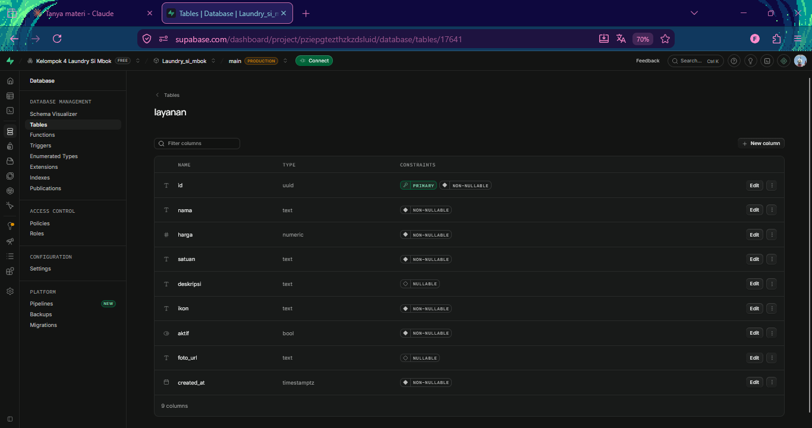
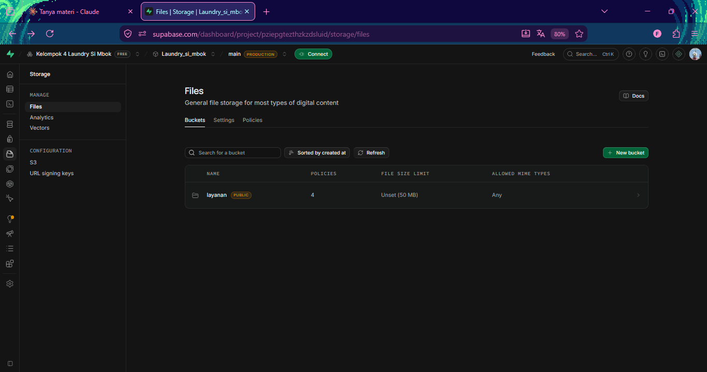
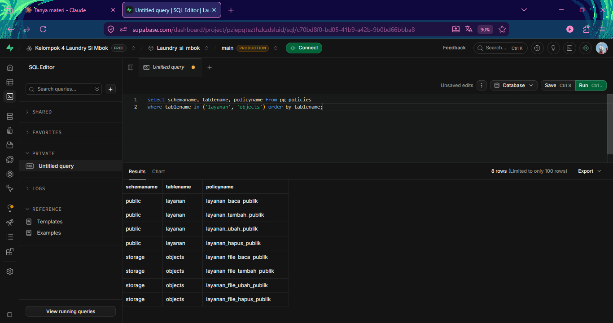
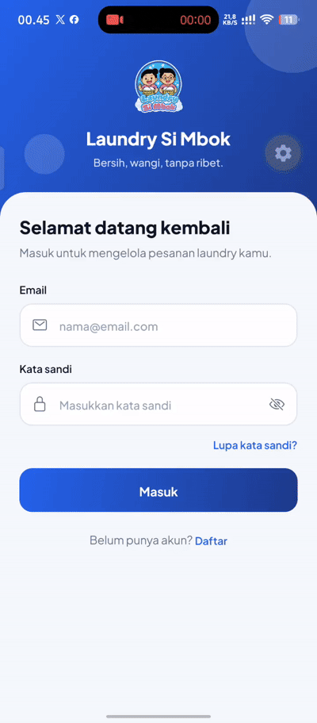
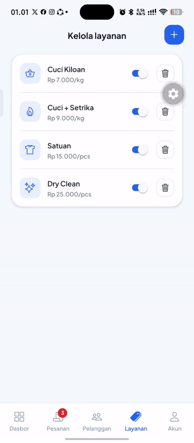
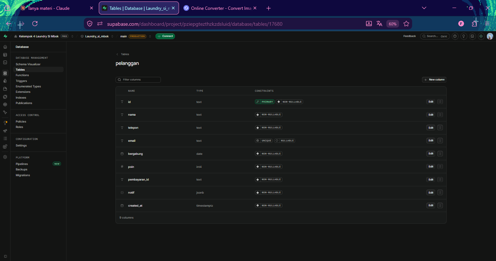
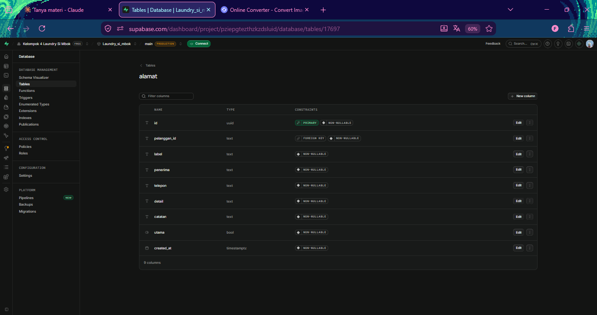
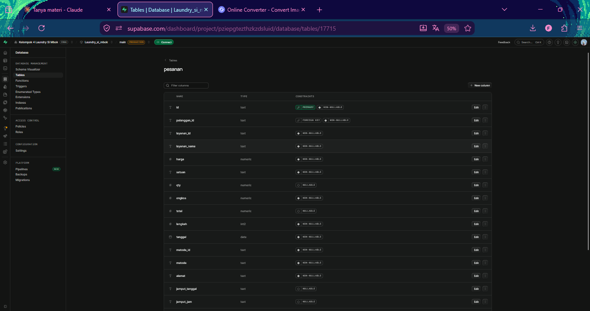
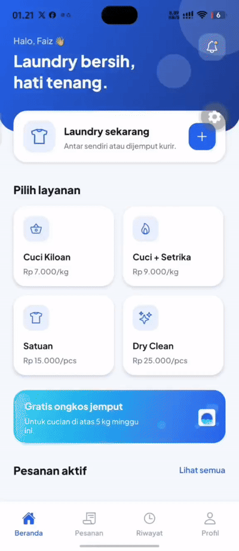

# Laporan Progres 4

## Anggota Kelompok

1. Faiz Muzaki Irsyad (2488010047)
2. Tanu Hasyim (2488010011)
3. Nayla Rahman Farhanah (2488010026)
4. Mohammad Satria Dinilhaq (2488010064)

## Integrasi Supabase: CRUD Layanan (Pertemuan 9)

Katalog layanan dipindah dari data dummy ke Supabase
(tabel `layanan` + bucket Storage `layanan` untuk foto).

### Setup Supabase
- Project dibuat satu kali oleh PM, anggota lain memakai URL dan key yang sama
- Tabel `layanan` + 4 data awal
  

- Bucket `layanan` (Public)
  

- RLS aktif dan 8 policy (4 tabel + 4 storage)
  

### Hasil di aplikasi
- Create (dengan foto), Read, Update, Delete dengan konfirmasi
  

- Validasi realtime: error muncul saat mengetik, tombol nonaktif
  

## Integrasi Supabase Tahap 2: Pelanggan, Alamat, Pesanan
- Tabel `pelanggan`, `alamat`, `pesanan`
  
  
  

- register, tambah alamat, dan buat pesanan
  
  

- Admin memajukan status dan menandai lunas, perubahannya tersimpan

### Yang masih lokal
Login belum memakai Supabase Auth (admin masih dicek lokal).
Kebijakan RLS masih terbuka untuk publik (hanya untuk praktikum).