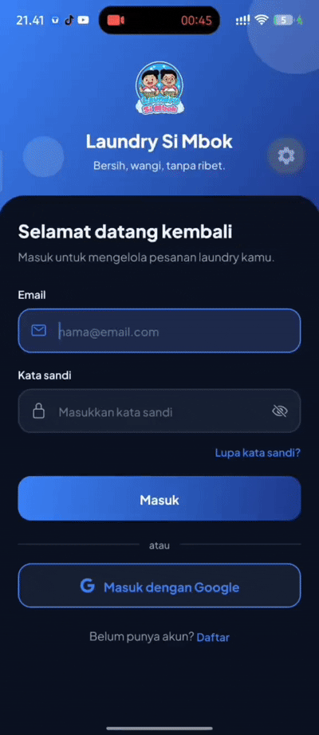
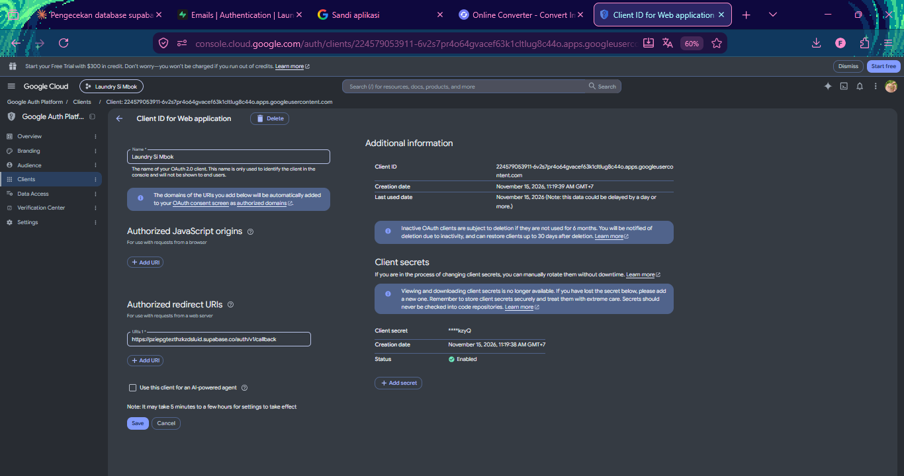
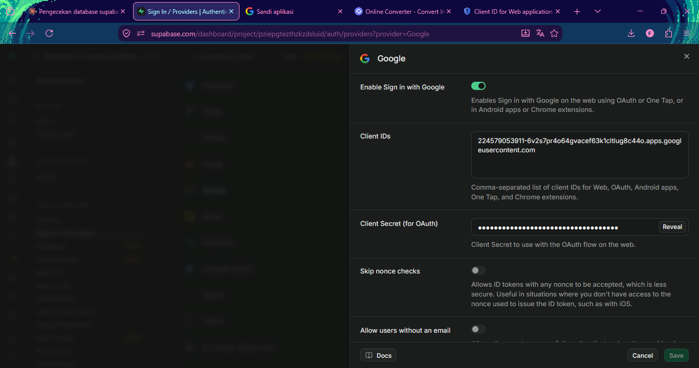
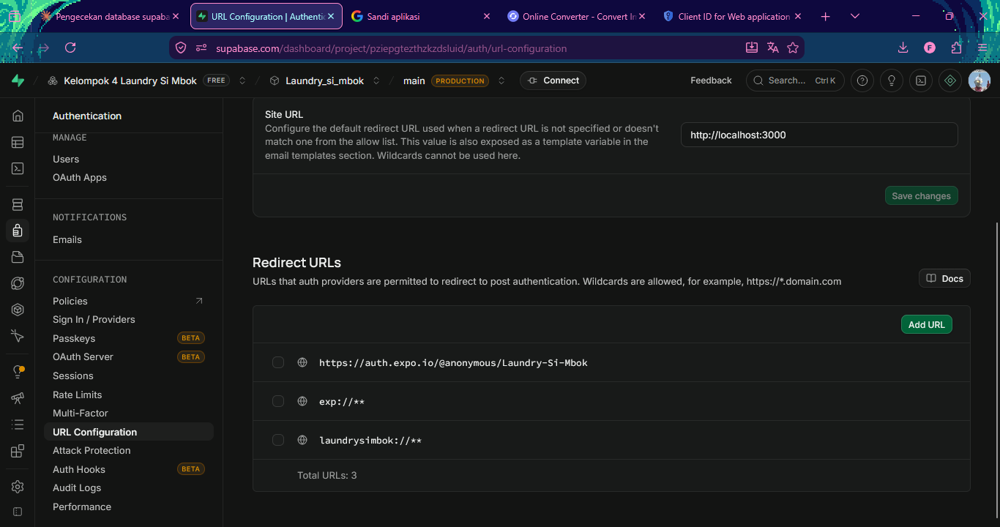
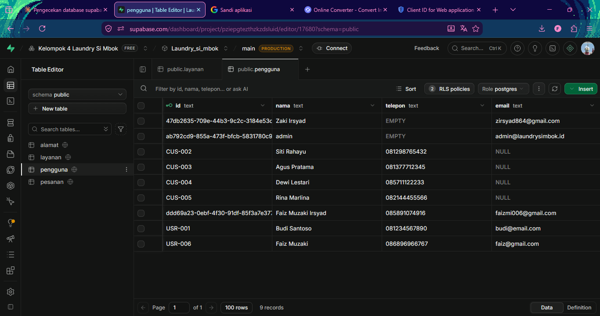
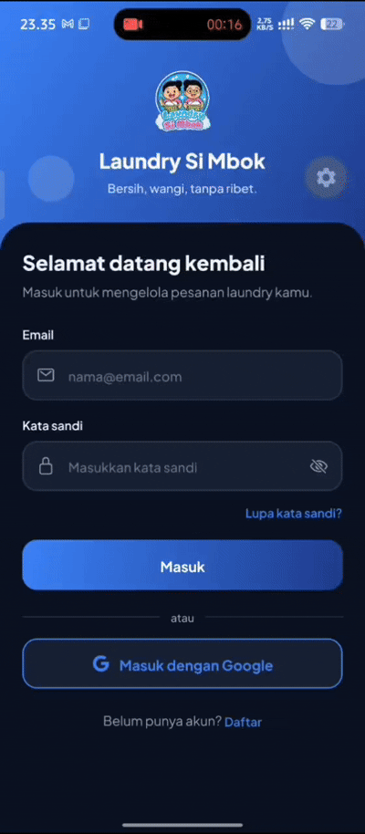
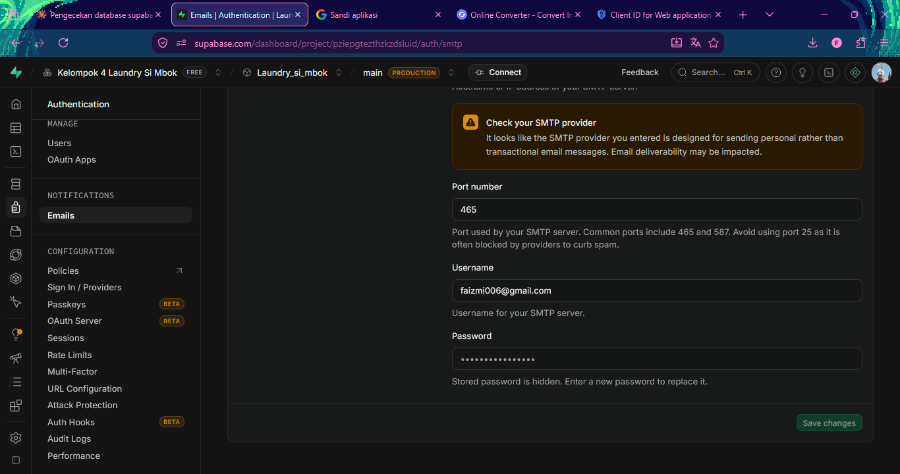

# Laporan Progres 5

## Anggota Kelompok

1. Faiz Muzaki Irsyad (2488010047)
2. Tanu Hasyim (2488010011)
3. Nayla Rahman Farhanah (2488010026)
4. Mohammad Satria Dinilhaq (2488010064)

## Login Google (OAuth) dan Lupa Kata Sandi (Pertemuan 10)

Laporan ini berfokus pada dua fitur yang ditambahkan di atas Supabase Auth: login dengan akun Google
(OAuth 2.0) dan pemulihan kata sandi. Dasarnya sudah ada dari tahap sebelumnya:
- Login dan daftar memakai Supabase Auth (email + kata sandi, disimpan sebagai hash oleh Supabase)
- Role (`user` atau `admin`) dibaca dari kolom `role` di tabel `pengguna`, bukan dari input pengguna
- Row Level Security (RLS) membatasi data per akun

## 1. Login Google (OAuth 2.0 + PKCE)

### Alur
1. Pengguna menekan "Masuk dengan Google" (halaman Login) atau "Daftar dengan Google" (halaman Daftar)
2. Aplikasi meminta Supabase membuat alamat login Google (`signInWithOAuth`), lalu membukanya di browser
3. Pengguna memilih akun Google di halaman Google
4. Google mengembalikan ke Supabase (`/auth/v1/callback`), lalu Supabase mengembalikan ke aplikasi membawa `code`
5. Aplikasi menukar `code` menjadi sesi (`exchangeCodeForSession`), lalu membaca role dari tabel `pengguna`

Aplikasi tidak pernah memegang kata sandi Google; yang tersimpan hanya sesi Supabase.

### Konfigurasi
Google Cloud Console:
- Project `Laundry Si Mbok`, OAuth consent screen tipe External (mode Testing, akun uji didaftarkan sebagai Test user)
- OAuth client tipe Web application dengan Authorized redirect URI `https://pziepgtezthzkzdsluid.supabase.co/auth/v1/callback`

Supabase Dashboard:
- Provider Google diaktifkan dengan Client ID dan Client secret (secret hanya diisi di dashboard, tidak ada di kode)
- Redirect URLs: `https://auth.expo.io/@anonymous/Laundry-Si-Mbok`, `exp://**`, `laundrysimbok://**`

### Profil otomatis untuk akun Google
- Akun Google baru otomatis dibuatkan baris `pengguna` oleh trigger `handle_new_user` di database
- Nama diambil dari akun Google, `role` selalu `user`, nomor telepon dikosongkan (diisi lewat Ubah Profil)
- Akun admin tidak bisa dibuat lewat Google; role admin hanya diberikan lewat database

### Kendala dan penanganan
| Kendala | Penanganan |
| --- | --- |
| Expo Go tidak bisa membuka alamat kembali ber-scheme custom (`laundrysimbok://`), sehingga login tidak kembali ke aplikasi | Alamat kembali di Expo Go dibuat dari alamat Metro: `exp://<ip>:<port>/--/auth/callback` |
| Di Android, tab browser tertutup sebelum alamat kembali tiba, sehingga login dianggap batal | Alamat kembali juga ditangkap lewat `Linking` dan ditunggu hingga 5 detik |
| Halaman konfirmasi dari proxy Expo (`auth.expo.io`) muncul sebelum kembali ke aplikasi | Normal untuk jalur proxy; pengguna mengetuk "Ya" |
| Proxy sesekali menampilkan "Terjadi kesalahan saat mencoba menyelesaikan proses masuk" | Konstanta `PAKAI_PROXY` disediakan untuk beralih ke jalur langsung tanpa proxy |

## 2. Lupa Kata Sandi

### Alur (dua langkah, satu layar)
1. Pengguna memasukkan email, lalu aplikasi meminta Supabase mengirim kode (`resetPasswordForEmail`)
2. Pengguna memasukkan kode dari email dan kata sandi baru; kode diverifikasi (`verifyOtp` tipe `recovery`), kata sandi diganti (`updateUser`), lalu sesi ditutup sehingga pengguna harus login ulang

Dipilih kode angka di email, bukan link, karena link ke aplikasi sulit diandalkan di Expo Go (alamatnya berubah-ubah).

### Konfigurasi email
- Template email "Reset password" diubah agar memuat kode (`{{ .Token }}`)
- Supabase hanya mengizinkan template diubah setelah custom SMTP dipasang, sehingga dipasang SMTP Gmail
  (`smtp.gmail.com`, port 465) memakai App Password
- Awalnya pengiriman gagal (log Supabase: `534 5.7.9 Application-specific password required`) karena kolom
  password SMTP berisi kata sandi Gmail biasa; setelah diganti App Password, email terkirim

### Keamanan
- Pesan sukses selalu sama untuk semua email, sehingga tidak membocorkan email yang terdaftar
- Kode dikirim ke email, berlaku sebentar, dan kode lama batal bila meminta kode baru
- Setelah kata sandi diganti, sesi ditutup dan pengguna harus login dengan kata sandi baru
- Pengiriman kode dibatasi (rate limit) oleh Supabase; aplikasi menampilkan pesan bila terlampaui

## Pengujian
| Skenario | Hasil |
| --- | --- |
| Login Google memilih akun yang terdaftar sebagai Test user, lalu masuk ke beranda pelanggan | |
| Baris `pengguna` baru ber-role `user` terbentuk setelah login Google pertama | |
| Login Google dibatalkan (tab ditutup) menampilkan pesan, aplikasi tidak error | |
| Akun Google di luar daftar Test user ditolak oleh Google | |
| Lupa kata sandi: email dengan akun terdaftar menerima kode | |
| Lupa kata sandi: kode benar + kata sandi baru berhasil, lalu login dengan kata sandi baru | |
| Lupa kata sandi: kode salah ditolak dengan pesan jelas | |
| Email tidak terdaftar mendapat pesan yang sama saat meminta kode | |
