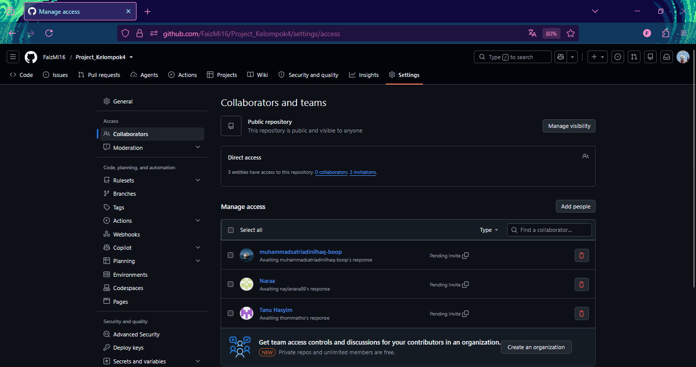
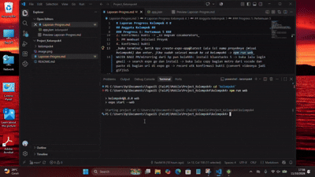
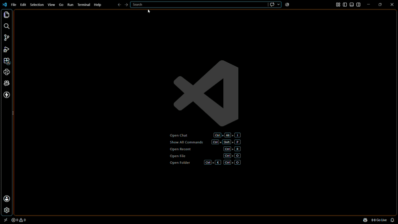
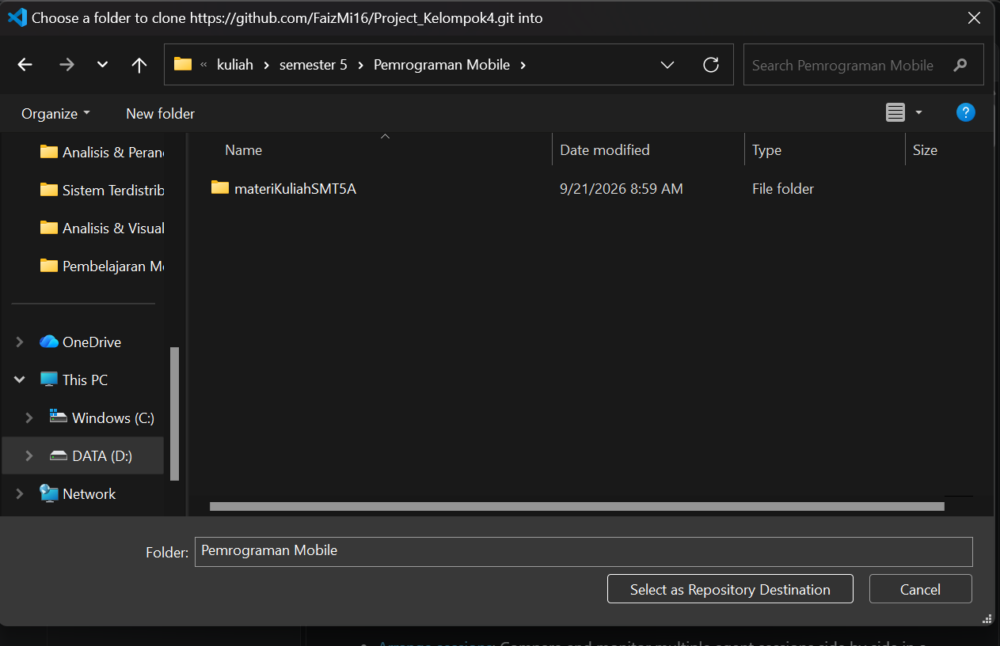
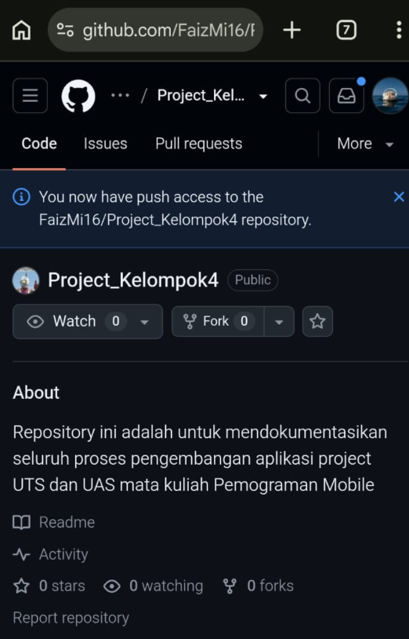

# Laporan Progress Kelompok 4

## Anggota Kelompok

1. Faiz Muzaki Irsyad
2. Tanu Hasyim
3. Nayla Rahman Farhanah
4. Mohammad Satria Dinilhaq

### Progress 1: Pertemuan 5

1. PM membuat repository dan invite member
2. Konfirmasi dokumentasi -> _ss bagian colaborators_
3. PM membuat inisiasi Proyek
4. Konfirmasi dokumentasi
   _buka terminal, ketik npx create-expo-app@latest lalu isi nama proyeknya (misal kelompok6) dan enter. jika sudah selesai masuk ke cd kelompok6 -> npm run web_
   WAJIB BAGI PM/mirorring dari hp pun bolehhh: install bluestacks 5 -> buka lalu login gmail -> search expo go dan install -> buka lalu copy bagian metro dari vscode dan paste di bagian url di expo go -> record utk konfirmasi dokumentasi (convert videonya jadi gif)SsS

dokumentasi PM:

Tugas Member:

1. Accept invitation
2. dokumentasi Konfirmasi -> _semua anggota harus meneyrtakan dokumentasinya_
3. Clone Proyek
4. dokumentasi Konfirmasi -> _semua anggota harus meneyrtakan dokumentasinya_

dokumentasi Tugas Member:

- Tanu Hasyim

- Nayla Rahman Farhanah

- Mohammad Satria Dinilhaq
  dokumentasi Clone Repo
  

  dokumentasi acc invite
  

Tugas Bersama Diskusi Penentuan Tema:

- PinjamIn - Peminjaman dan Pengembalian barang (Mohammad Satria Dinilhaq)
- KopiKuy - aplikasi kasir coffee shop (Faiz Muzaki Irsyad)
- FiNote - aplikasi personal budgeting
