# Notulensi Hasil Wawancara

## Profil UMKM

1. **Nama UMKM:** Laundry Si Mbok
2. **Bidang Usaha:** Jasa Laundry Antar Jemput
3. **Pemilik:** Ibu Ara
4. **Alamat:** Jl. Perjuangan No. 55a, Sunyaragi, Kec. Kesambi, Kota Cirebon, Jawa Barat 45135
5. **No. Telepon:** 0812 2585 5805

---

## 1. Identitas Wawancara

- **Narasumber:** Ibu Ara, pemilik Laundry Si Mbok
- **Pewawancara:** Faiz Muzaki
- **Kameramen:** Satria Dinilhaq
- **Notula:** Tanu Hasyim
- **Hari/Tanggal:** Minggu, 18 Oktober 2026
- **Tempat:** Laundry Si Mbok
- **Topik:** Proses bisnis, pengelolaan pesanan, pelayanan pelanggan, dan kebutuhan sistem informasi laundry.

## 2. Tujuan Wawancara

Wawancara ini bertujuan untuk memahami proses operasional Laundry Si Mbok, mulai dari penerimaan pakaian, pencatatan pesanan, proses pencucian, pengelolaan pembayaran, hingga penyerahan pakaian kepada pelanggan. Wawancara juga bertujuan mengidentifikasi kendala operasional dan kebutuhan sistem informasi yang dapat membantu meningkatkan efisiensi serta kualitas pelayanan.

## 3. Hasil Wawancara

### A. Profil dan Operasional Usaha

Laundry Si Mbok merupakan UMKM yang bergerak di bidang jasa laundry antar jemput. Usaha ini melayani kebutuhan pencucian pakaian pelanggan, termasuk kebutuhan penjemputan dan pengantaran sesuai layanan yang tersedia. Dalam operasionalnya, pemilik perlu mengelola data pesanan, memastikan pakaian diproses dengan baik, memantau penyelesaian pekerjaan, dan menjaga komunikasi dengan pelanggan.

### B. Alur Proses Bisnis

Berdasarkan gambaran umum usaha laundry, alur pelayanan dapat meliputi:

1. Pelanggan menghubungi laundry atau datang langsung untuk menggunakan layanan.
2. Pemilik atau petugas menerima permintaan dan mencatat informasi pesanan.
3. Pakaian diterima, ditimbang atau dihitung sesuai ketentuan layanan, kemudian biaya dihitung.
4. Pakaian diproses melalui tahap pencucian, pengeringan, penyetrikaan, dan pengemasan sesuai layanan yang dipilih.
5. Petugas memperbarui status pengerjaan hingga pesanan selesai.
6. Pelanggan melakukan pembayaran sesuai biaya layanan.
7. Pakaian diambil oleh pelanggan atau diantarkan ke alamat yang telah disepakati.

### C. Kendala yang Perlu Diidentifikasi

Beberapa hal yang perlu dikonfirmasi kepada pemilik terkait operasional sehari-hari meliputi:

- Cara pencatatan pesanan dan data pelanggan.
- Cara memantau status pesanan yang sedang dikerjakan.
- Cara pelanggan mengetahui perkiraan waktu selesai.
- Cara mencatat pembayaran dan menyusun laporan pendapatan.
- Cara mengatur alamat serta jadwal antar jemput.
- Cara menangani perubahan pesanan, keterlambatan, atau keluhan pelanggan.

Poin-poin tersebut merupakan area identifikasi kebutuhan, bukan pernyataan bahwa seluruh kendala tersebut pasti terjadi di Laundry Si Mbok.

### D. Kebutuhan Sistem Informasi

Untuk mendukung operasional jasa laundry antar jemput, fitur sistem yang dapat dipertimbangkan meliputi:

1. **Pencatatan pesanan:** Menyimpan data pelanggan, jenis layanan, berat pakaian, harga, dan tanggal pesanan.
2. **Pemantauan status laundry:** Menampilkan status pesanan, misalnya diterima, dicuci, disetrika, selesai, dan diantar atau diambil.
3. **Informasi pesanan pelanggan:** Membantu pelanggan mengetahui perkembangan pesanan.
4. **Pengelolaan antar jemput:** Mencatat alamat, jadwal penjemputan, dan pengantaran.
5. **Pengelolaan pembayaran:** Mencatat biaya layanan, status pembayaran, dan riwayat transaksi.
6. **Laporan usaha:** Membantu rekap jumlah pesanan dan pendapatan berdasarkan periode tertentu.

### E. Harapan terhadap Sistem

Sistem informasi yang dikembangkan diharapkan dapat membantu pemilik mengelola pesanan secara terstruktur, mempermudah pemantauan status pengerjaan, mengurangi risiko kesalahan pencatatan, serta meningkatkan kemudahan layanan antar jemput bagi pelanggan. Fitur yang dipilih perlu disesuaikan dengan kebutuhan nyata dan kapasitas operasional usaha.

## 4. Kesimpulan

Pengelolaan UMKM jasa laundry antar jemput memerlukan proses pencatatan pesanan, pemantauan pengerjaan, pengelolaan pembayaran, dan koordinasi pengantaran yang teratur. Pengembangan aplikasi untuk Laundry Si Mbok dapat dipertimbangkan sebagai sarana untuk mendukung proses tersebut. Kebutuhan akhir sistem perlu ditetapkan setelah dilakukan konfirmasi langsung dengan pemilik usaha.

## 5. Tindak Lanjut

1. Mengonfirmasi alur kerja yang benar-benar diterapkan oleh Laundry Si Mbok.
2. Mencatat kendala aktual berdasarkan jawaban pemilik.
3. Menentukan kebutuhan fitur dan hak akses pemilik, petugas, kurir, serta pelanggan jika diperlukan.
4. Menyusun rancangan alur sistem dan antarmuka aplikasi.
5. Meminta masukan pemilik terhadap rancangan sebelum pengembangan.

## 6. Penutup

Demikian draf notulensi hasil wawancara dengan pemilik UMKM Laundry Si Mbok ini disusun sebagai dokumentasi awal untuk memahami proses bisnis dan merumuskan kebutuhan sistem informasi laundry.

## 7. Dokumentasi

Dokumentasi Wawancara
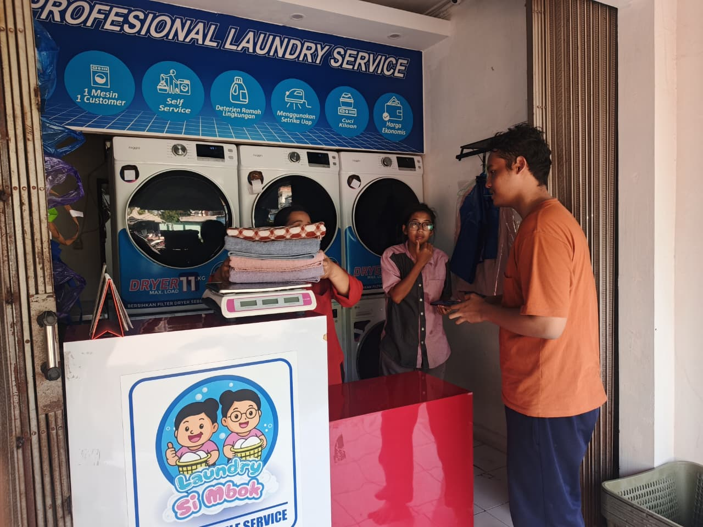

Dokumentasi Proyek
[Link Dokumentasi](https://drive.google.com/drive/folders/12k3IGj147Bej6HqmB9Fkl5lguhRy7bxz)

## 8. Screenschoot

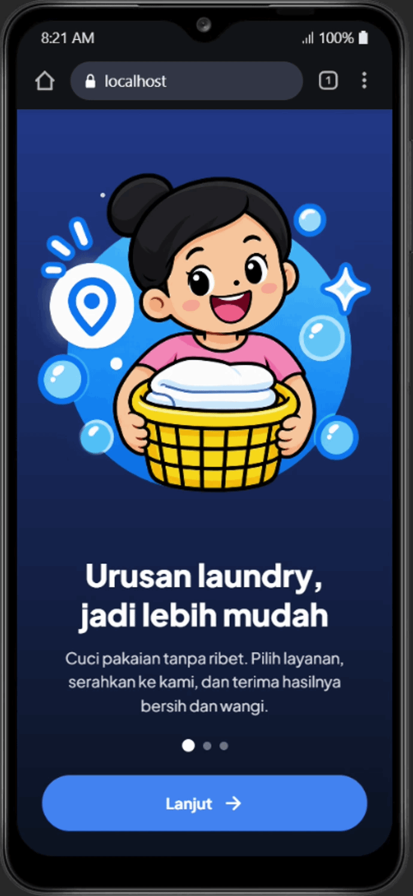
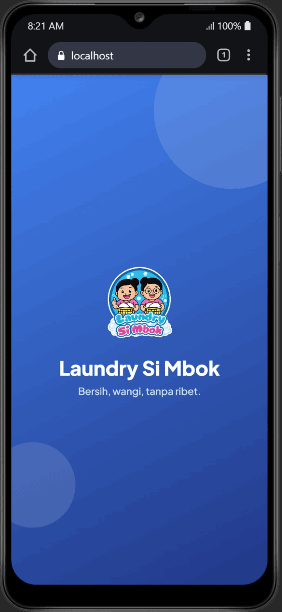
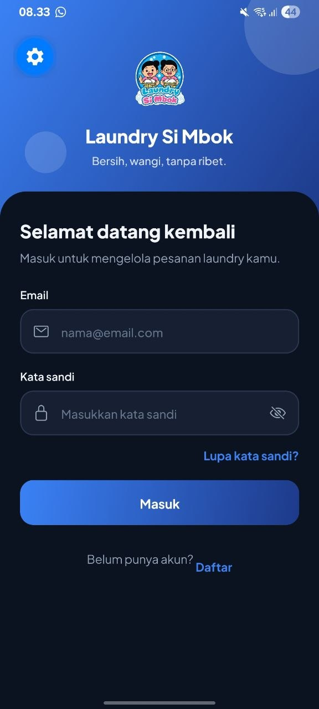
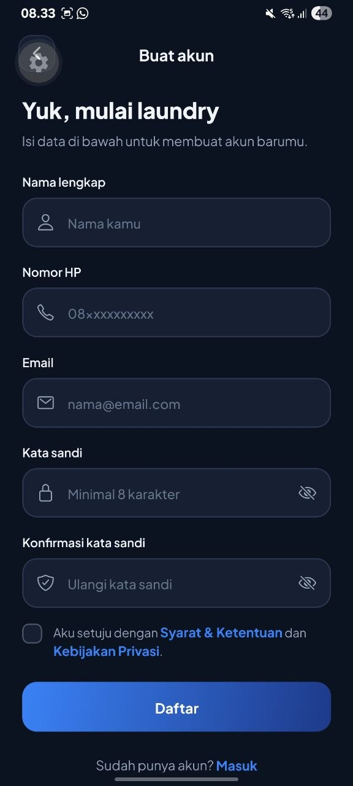
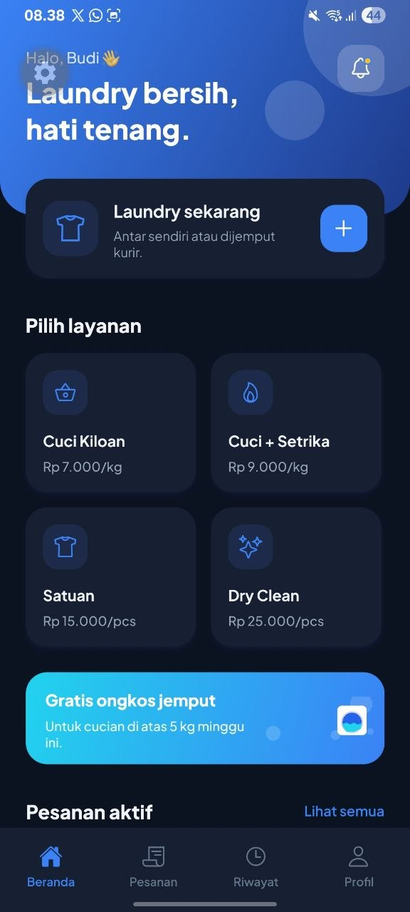
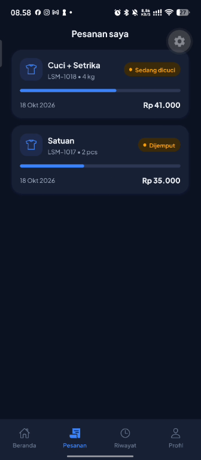
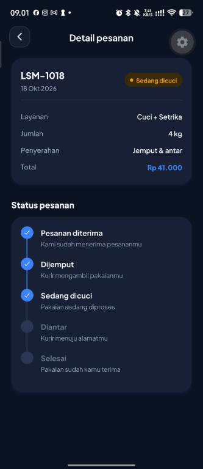
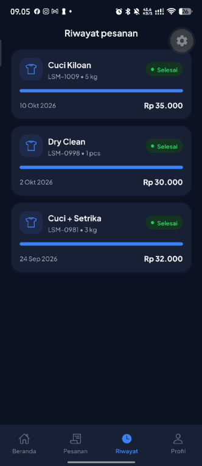
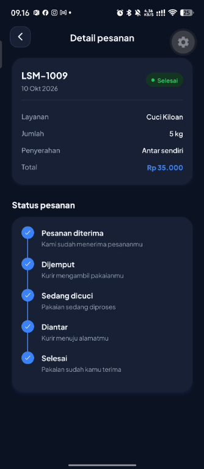
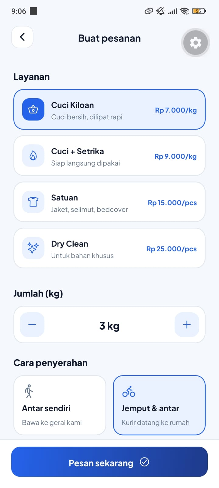
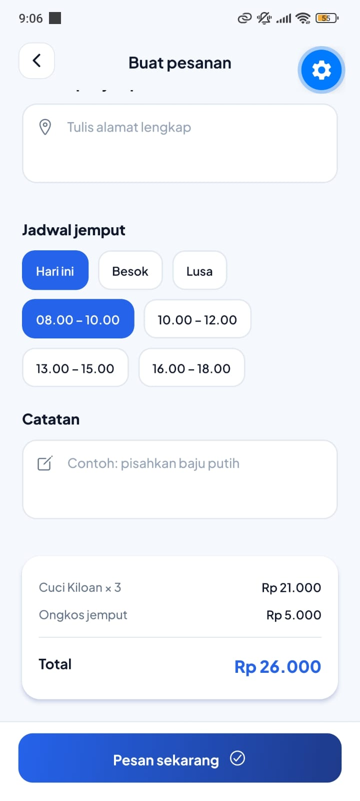
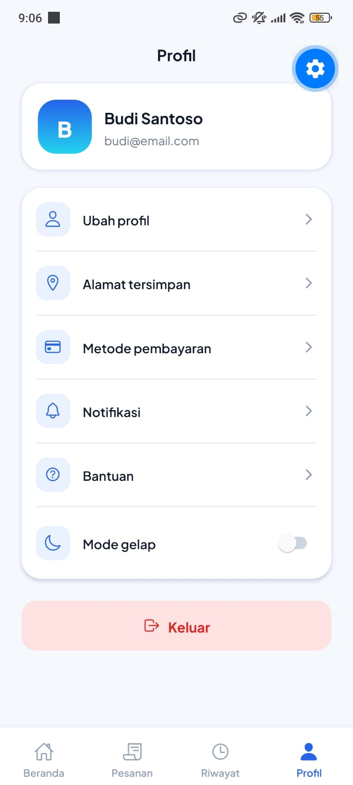
